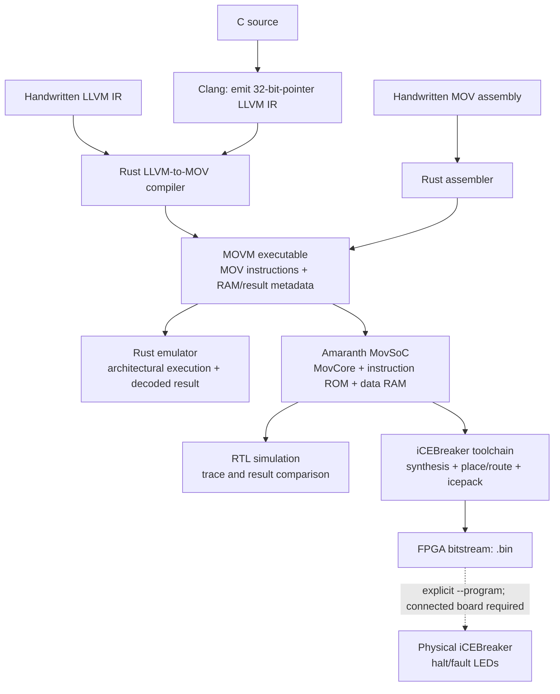

# MOV Machine

[Repository README](../README.md)

MOV-only FPGA processor in Amaranth, dependency-free Rust LLVM-IR compiler/assembler/emulator, combined Nix development environment, and independent formal specifications.

The compiler uses memory-alias equality and table selection from Stephen Dolan's [*mov is Turing-complete*](https://drwho.virtadpt.net/files/mov.pdf). Variable arithmetic, control flow and source-memory accesses lower to the existing four MOV instructions; the FPGA has no guest ALU. [Supported LLVM subset and ABI](compiler.md).

## Project at a glance



The same instructions run in the emulator and RTL; the MOVM header configures loaders, not the CPU decoder. Building a bitstream is separate from programming or measuring hardware. Diagrams use editable Mermaid fenced blocks, rendered by GitHub and Mermaid-enabled Markdown viewers; other viewers show their source.


## Start

```sh
nix develop --impure
mkdir -p build
mov-compile examples/llvm/sum.ll build/sum.mov
mov-run build/sum.mov --max-steps 500000
mov-check
mov-formal
mov-build build/sum.mov
```

The example returns decoded `result: 42`; its architectural halt code identifies the result RAM region. The reference FPGA target is iCEBreaker; the build creates a real bitstream without automatically programming hardware.

## Documentation

* [Usage](usage.md): LLVM/C compilation, assembly, emulator/trace CLI, and a build-versus-programming diagram.
* [Architecture](architecture.md): instruction encoding, ROM/RAM/core connections, execution-state diagram, reset/fault rules and RTL buses.
* [Compiler](compiler.md): lowering pipeline, paper primitives, logical-memory mapping and encoded return diagram.
* [Formal verification](formal.md): verification-layer diagram, RTL proof contract and finite TLA+/Alloy scopes.
* [Environment](environment.md): diagram of the combined Rust, Amaranth, electronics and formal development shell.
* [Verification results](verification.md): exercised checks and limits.

## Source layout

| Path | Responsibility |
|---|---|
| `hw/mov_machine/core.py` | Board-neutral MOV core |
| `hw/mov_machine/soc.py` | Synchronous ROM/RAM integration |
| `hw/mov_machine/build.py` | iCEBreaker wrapper and RTL/bitstream builds |
| `src/` | Rust LLVM parser/MOV compiler, assembler, executable format, emulator and CLI |
| `tests/` | Rust behavioral regressions |
| `formal/` | Independent RTL reference, induction/cover runner, TLA+ and Alloy models |
| `scripts/verify.py` | Actual CLI-to-RTL differential simulation |
| `examples/` | LLVM/C compiler inputs and handwritten pure-MOV programs |
| `docs/` | Project documentation |

Generated images, netlists, bitstreams, traces and solver artifacts live in ignored `build/`. Locks are retained as source.
