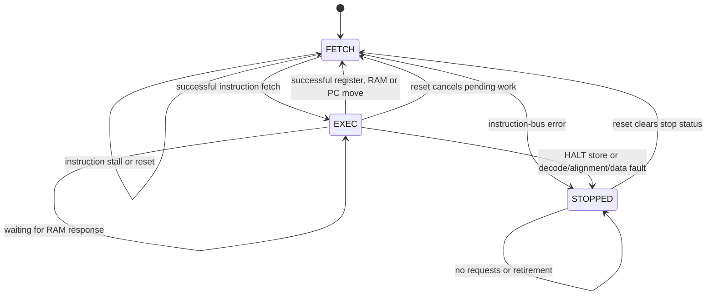
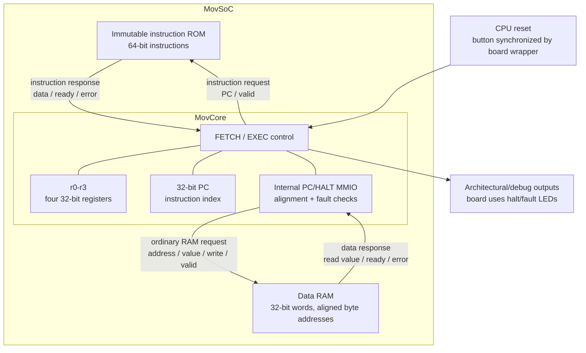

# Machine architecture

## ISA

Four writable 32-bit registers, `r0`–`r3`. All values and effective-address additions wrap modulo 2³². There are no arithmetic, compare, conditional-execution, call, return, or branch opcodes. Hardware address addition and sequential-PC increment are not guest arithmetic instructions.

| Opcode | Assembly | Effect |
|---|---|---|
| 0 | `mov rD, rS` | Copy register |
| 1 | `mov rD, immediate` | Copy a full 32-bit constant |
| 2 | `mov rD, [rS + offset]` | Load a 32-bit word |
| 3 | `mov [rD + offset], rS` | Store a 32-bit word |

`mov.rr`, `.ri`, `.rm`, `.mr` are accepted with the same **destination-first** operands, and their suffix must match the operand form. Negative offsets work: `mov r0, [r1 - 4]`. Memory-to-memory and immediate-to-memory moves are not instructions.

## Local executable format

A `.mov` executable begins with a 32-byte little-endian MOVM version-1 header:

| Byte offset | Encoding |
|---|---|
| 0–7 | Magic/version bytes `4d 4f 56 4d 01 00 00 00` |
| 8–11 | Instruction count, unsigned 32-bit |
| 12–15 | Minimum physical RAM capacity in words |
| 16–19 | Encoded result RAM address, or zero for native assembly |
| 20–23 | Encoded result width 1–32 bits, or zero for native assembly |
| 24–31 | Reserved; must be zero |

Exactly the declared number of eight-byte instructions follows. Each instruction has a little-endian 32-bit header followed by a 32-bit extension (immediate or address offset). Old headerless images are rejected; reassemble them rather than relying on ambiguous fallback decoding. Instruction bits are still checked by execution, so malformed instructions produce precise machine faults.

Header: bits 31–26 opcode, bits 25–24 destination register, bits 23–22 source register, bits 21–0 zero. For register copies, the extension must be zero. For immediate copies, the source-register field must be zero. Opcodes above 3 and noncanonical encodings fault.

This is the local format for both the Rust compiler and native assembler, not ELF or an upstream Movsucator object format. Encoded results occupy aligned RAM words containing 0/4 Boolean bits; their declared region must fit the minimum RAM capacity. The compiler's [return ABI](compiler.md#return-abi) is separate from architectural `halt_code`.

The PC is a 32-bit **instruction index**, not a byte address. Labels in assembly resolve to indices. Code is immutable, separate from data RAM. There is no implicit halt at the end of an image; fetching outside it faults.

## Data address space

Native-image default RAM: 256 zero-initialized 32-bit words, byte addresses `0x00000000`–`0x000003ff`. Compiled-image loaders increase the default to the image's required capacity; an explicit insufficient capacity is rejected. All physical data accesses must be four-byte aligned. Each access uses the pre-instruction register values, including when the load destination aliases the address register. LLVM logical bytes are mapped to this word RAM by generated MOV code.

| Address | Read | Write |
|---|---|---|
| RAM | Load word | Store word |
| `0xfffffff8` | Fault | Halt and latch store value as `halt_code` |
| `0xfffffffc` | Current instruction index | Set PC to the store value (instruction index) |
| Other address | Fault | Fault |

MOV-to-PC supplies control flow without a branch opcode. A table lookup can select the next PC: [table-branch.s](../examples/table-branch.s). This alone is **not a proof of compiler arithmetic lowering or Turing completeness**.

## Architectural transitions

* Reset clears registers, PC, captured instruction, halted/fault status, and halt code. Core state becomes FETCH. CPU reset preserves RAM; initial FPGA configuration initializes it to zero.
* Successful instructions increment PC by one, except PC stores, which use the stored value. Successful HALT stores increment PC before stopping.
* A fault sets `halted` and `fault`, preserving PC, registers, RAM and halt code for that instruction. Faulting instructions do not retire.
* Halt/fault are sticky until reset. Stopped cores issue no requests and do not retire instructions.
* The Rust `steps` counter counts attempted instructions, including a faulting fetch/decode; it is diagnostic, not an RTL state field. Calls to `step()` after stopping do not count.

### Execution phases

`STOPPED` is a diagram-level status overlay (`halted = 1`), not a third RTL FSM encoding; the encoded phases are FETCH and EXEC. Successful HALT advances PC, while a fault preserves that instruction's architectural state. Reset has priority over every arrow and preserves RAM.

## RTL interfaces

`hw/mov_machine/core.py:MovCore` implements FETCH and EXEC phases. Its instruction bus transfers a 64-bit encoded instruction at `imem_addr` (an index). The data bus transfers a 32-bit word at `dmem_addr` (a byte address). Both complete on `valid && ready`. Read data/error are sampled at that edge. Error signals without a completed request have no effect.

Requests and architectural state remain stable while stalled. Explicit synchronous `reset` has priority and suppresses requests and retirement. The normal Amaranth `sync` domain reset also resets the core. Data-bus targets must not commit faulting stores, and must commit valid stores only on a successful completion edge. MMIO and alignment checks happen inside the core; MMIO never reaches the external data bus.

`hw/mov_machine/soc.py:MovSoC` adds synchronous block-memory-friendly ROM/RAM and a two-cycle request/completion handshake. Stores commit only at completion, so reset can cancel outstanding work. Its constructor accepts 1–16384 instructions and 1–1024 RAM words; these are validation bounds, not promises of reference-board resource fit. The emulator can use larger images and RAM within the 32-bit non-MMIO address space. FPGA capacity and place/route are the deployment limit.

Architectural debug signals: `pc`, `regs`, `halted`, `fault`, `halt_code`; execution debug: `state`, `instruction`, `retire`. The core is board-neutral; the reference board wrapper synchronizes its reset button and drives status LEDs.

Both buses complete on `valid && ready`. PC/HALT accesses are resolved inside the core and never reach RAM; the external data bus has no arithmetic device. The MOVM file header is consumed by loaders before this circuit receives the instruction words.

