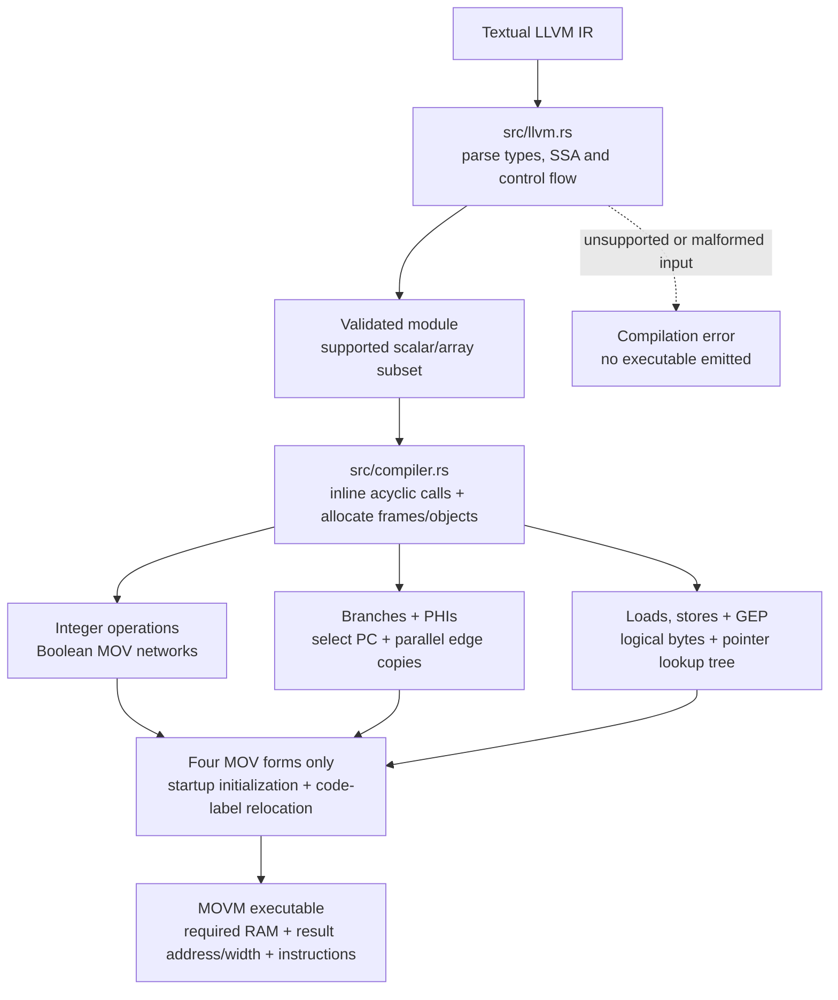
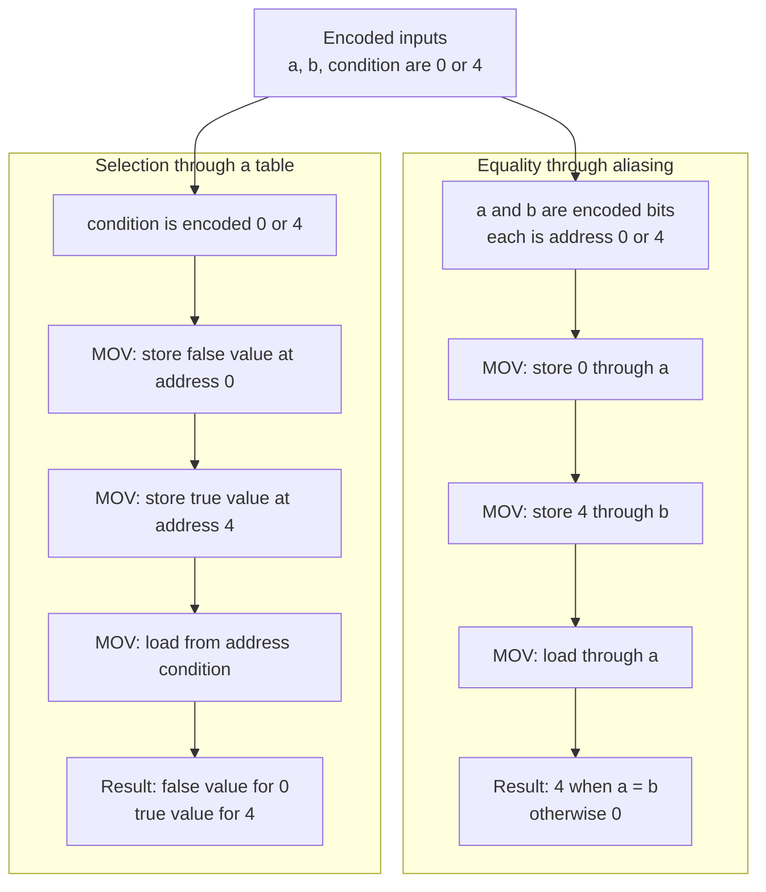
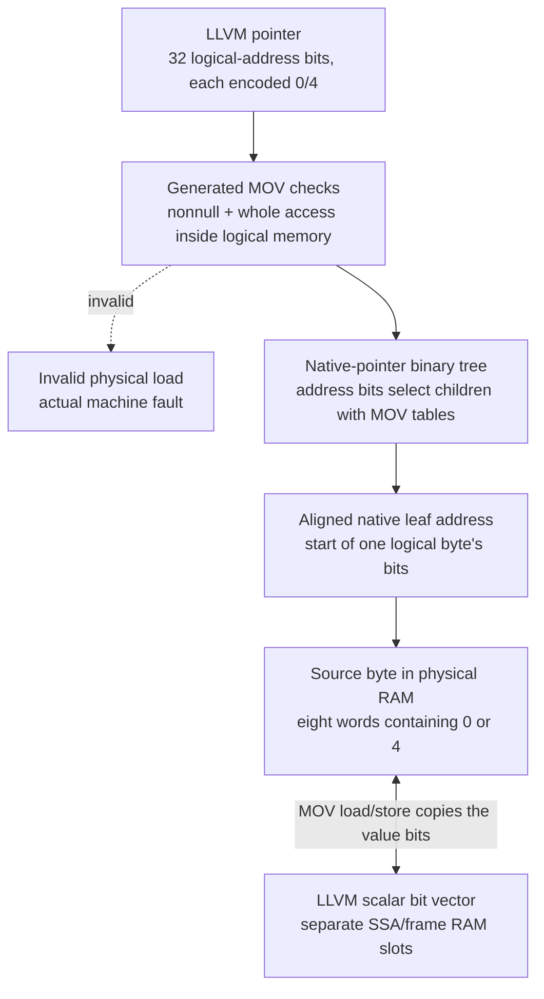
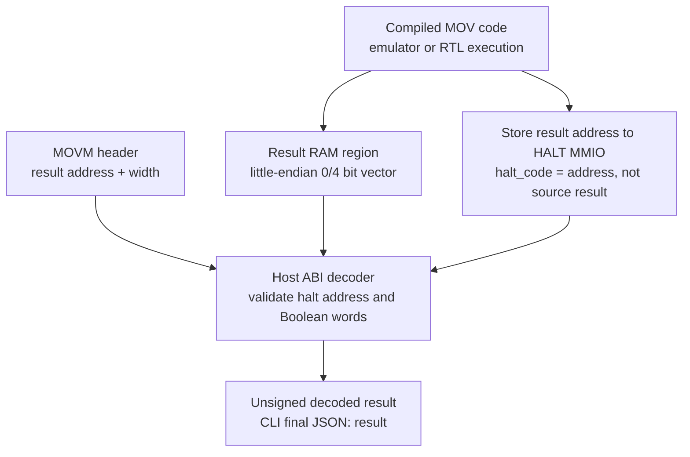

# LLVM IR → MOV compiler

The compiler is implemented in Rust in `src/llvm.rs` (textual LLVM frontend) and `src/compiler.rs` (MOV lowering). It replaces the earlier dependency on Hussdev0/movsucator; no upstream backend, native object emitter, or x86 MOVfuscator output is required.

Clang is an optional producer of this textual input; the Rust compiler does not link LLVM. Layout/lowering resource errors also stop compilation before an executable is written.

## Source contract

Supported scalar values: `i1`, `i8`, `i16`, `i32`, and 32-bit opaque `ptr`. Storage aggregates are fixed, nested arrays of supported elements; array-valued SSA operations are not supported. Logical source memory is little-endian; an explicit data layout must use 32-bit default-address-space pointer size/alignment/index width and the target's standard scalar ABI alignments. Without an explicit layout, this target's 32-bit layout applies.

Operations:

* `add`, `sub`, `mul`, `udiv`, `sdiv`, `urem`, `srem`.
* `and`, `or`, `xor`, `shl`, `lshr`, `ashr` with variable operands.
* Every integer `icmp` predicate and `select`.
* `trunc`, `zext`, `sext`, scalar `bitcast`, `ptrtoint`, `inttoptr`.
* Basic blocks, `br`, parallel edge-specific `phi` assignments, `ret`, `unreachable`.
* Acyclic direct calls, including void calls and multiple return blocks, lowered by inlining with independent call-site storage.
* Integer/array globals, constant-sized entry-block `alloca`, scalar loads/stores, and scalar/nested-array `getelementptr` with variable and signed indices.

The frontend validates the supported typed IR and rejects unsupported executable constructs. Common nonexecuting Clang attributes, metadata and debug bookkeeping do not add operations to the target. External/indirect/variadic calls, recursion, floating point, vectors, structs, atomic/volatile memory, exception handling, dynamic allocations, unsupported executable intrinsics, relocatable global initializers, executable constant expressions, explicit `undef`/`poison` operands and quoted all-numeric identifiers are not supported. It is an integer LLVM backend, **not all of LLVM or a libc implementation**.

LLVM `nsw`, `nuw`, `exact` and `inbounds` specify when source executions are defined. The compiler preserves defined-input behavior; it does not implement a separate poison tracking engine or promise outcomes for violated source constraints. Wrapping arithmetic and concrete overshift results can refine poison cases without eagerly faulting an unselected result. Division by zero and invalid target memory access deliberately execute an invalid physical load and produce a real machine fault. Signed division truncates toward zero; remainder follows the numerator's sign.

## How the paper is used

Reference: Stephen Dolan, [*mov is Turing-complete*](https://drwho.virtadpt.net/files/mov.pdf), especially §§4–6.

The paper proves that memory aliasing can test equality and that two-element tables can select a value without a conditional instruction. Its complete construction simulates a Turing machine; it does **not supply an LLVM arithmetic backend**.

This compiler directly lowers LLVM using those primitives rather than inserting a Turing-machine interpreter:

1. Runtime integer/pointer values are little-endian **bit vectors**. Each bit occupies one physical RAM word containing `0` or `4`.
2. Physical words at byte addresses 0 and 4 are reserved scratch. Encoded bits are also addresses of these scratch words. To compare bits `a` and `b`, write zero through `a`, write four through `b`, then load through `a`. The result is four exactly when the addresses alias. Arbitrary LLVM integers are never used as physical pointers.
3. Selection stores the false and true alternatives in the two scratch words and loads `[condition + 0]`. Encoded condition 0/4 selects the appropriate word. More general tables use the same fixed-base displacement technique.
4. Boolean operations build ripple-carry add/subtract networks, partial-product multiplication, restoring division/remainder, and barrel shifts. Arithmetic happens through MOV loads/stores, **not through arithmetic opcodes, host callbacks, or MMIO ALUs**.
5. Conditional control flow selects one of two native instruction indices and MOVs it into PC MMIO. This adapts the paper's looping mechanism to this FPGA; it is not a literal x86 reproduction.
6. SSA values live in RAM. `r0`–`r2` are working registers; `r3` stays zero for fixed-address accesses. This uses the machine's constant displacements instead of reproducing the paper's circular scratch-list register reduction.

Code is immutable. There is no self-modification or runtime code generation. Fully constant operations and identities may be folded at compile time; variable operands still execute MOV networks.

### The two building blocks

Both sequences reuse the same two physical scratch words, so their contents are temporary. Each box summarizes load/store operations; immediate-to-memory MOV is not an ISA instruction, and the compiler uses registers to perform the stores. There is no hidden equality opcode or conditional branch in these sequences.

## Logical memory versus physical RAM

LLVM pointers contain logical byte addresses, represented as 32-bit bit vectors. Byte zero is null and cannot be dereferenced. Globals and static call-site allocations receive aligned logical ranges beginning above zero.

A source byte occupies eight physical Boolean words. A binary tree maps a valid logical byte address to the physical start of its bits. Traversal loads both children and selects one with a scratch table; no new register-indexed instruction is needed. Whole-access bounds checks run before loads/stores. Adjacent source bytes map to adjacent bit slots, preserving little-endian typed loads and byte aliasing.

`--memory-bytes` selects a power-of-two logical capacity, 2–128 bytes (default 32). Source-memory storage is allocated only when needed. Its physical overhead is `8*M + 2*(M-1)` words: 318 words at 32 logical bytes, before SSA values, result storage and scratch. The default compiler RAM budget is 1024 words; the emulator can use a larger explicit budget. The reference FPGA supports at most 1024 physical RAM words.

Per-instruction scratch is reused; generated SSA/call-site storage remains distinct. Startup reinitializes private RAM, globals, arguments and mapping tables, so CPU reset can rerun the program even though the hardware preserves RAM. Static function-local storage is reused on repeated executions of the same inlined call site; source programs must respect LLVM object lifetime rules.

The compiler reports exact instruction count and required RAM and rejects insufficient storage before emitting an executable. Valid source programs can exceed the reference FPGA's ROM/RAM resources; successful emulation does not establish physical fit.

For example, source byte `5` (`00000101` in binary) occupies words `[4, 0, 4, 0, 0, 0, 0, 0]`, least-significant bit first. Tree words contain native addresses, not encoded Boolean values. Pointer arithmetic is compiled separately into Boolean networks before this lookup; source integers are never handed directly to the physical RAM bus as addresses.

## Return ABI

A MOV-only machine cannot cheaply reconstruct an arbitrary native 32-bit integer from separate runtime bits. Compiled programs therefore return their encoded bit vector in a declared RAM region and halt with that region's **physical address**.

The versioned MOVM image records required RAM, result address and result width. `Machine::result()` decodes the vector after successful halt. The CLI adds `result` to the final JSON object for compiled images. `halt_code` remains the architectural address; it is **not** the source function's integer result. A void entry returns decoded zero.

Host decoding is output interpretation, not guest arithmetic execution. Native assembly images retain the native `halt_code` ABI. See [architecture](architecture.md) for the image format and [usage](usage.md) for CLI commands.

The decoder reads RAM only after successful halt. This diagram describes emulator/RTL result observation, not an implemented physical-board readback interface; the iCEBreaker wrapper currently exposes only halt/fault LEDs. Guest arithmetic is already complete before host decoding.

## Assembly interface

The handwritten assembly path remains useful for inspecting the machine and testing primitives:

* Destination-first `mov` and matching `.rr`, `.ri`, `.rm`, `.mr` suffixes.
* Registers `r0`–`r3`; decimal/hex constants with optional `#`, range `-2147483648`–`4294967295`.
* Labels resolve to instruction indices. Memory operands: `[rN]`, `[rN + number]`, `[rN - number]`.
* `;`/`//` comments; `.text`, `.globl`, `.global`, `.type`, `.size`, `.p2align` metadata. Alignment metadata does not add padding to index-based code.
* Unknown instructions and layout/data directives fail. Handwritten programs explicitly halt through HALT MMIO.

## Verification boundary

Compiler-generated output is checked against LLVM/native reference executions and both Rust and cycle-accurate RTL execution. Behavioral regressions exercise variable arithmetic, signedness, overflow/carry, division faults, shifts, loops/PHI swaps, calls, byte memory, aliases, bounds and reset.

Existing RTL induction establishes the machine's ISA, not a theorem that this compiler preserves all supported LLVM programs. No whole-compiler formal correctness claim is made. [Formal claims](formal.md) and [observed verification](verification.md) distinguish these layers.
