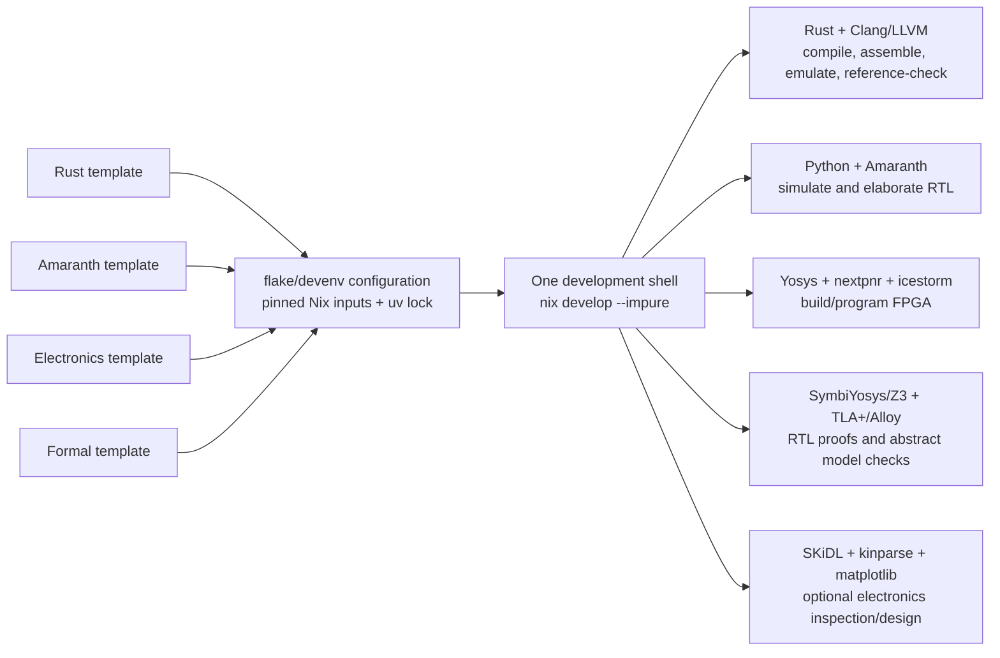

# Combined development environment

Source templates: [rft/nix-config](https://github.com/rft/nix-config), pinned to [`d64ef782324be96936a005898954dcfd24b4f78f`](https://github.com/rft/nix-config/tree/d64ef782324be96936a005898954dcfd24b4f78f/templates). This project's root environment merges their capabilities, not four nested shells.

| Upstream template | Retained here |
|---|---|
| [rust](https://github.com/rft/nix-config/tree/d64ef782324be96936a005898954dcfd24b4f78f/templates/rust) | Rust stable via rust-overlay; Cargo tooling |
| [amaranth](https://github.com/rft/nix-config/tree/d64ef782324be96936a005898954dcfd24b4f78f/templates/amaranth) | Python/uv, Amaranth, amaranth-boards, Yosys, Surfer |
| [python-electronics](https://github.com/rft/nix-config/tree/d64ef782324be96936a005898954dcfd24b4f78f/templates/python-electronics) | SKiDL, kinparse, matplotlib |
| [formal](https://github.com/rft/nix-config/tree/d64ef782324be96936a005898954dcfd24b4f78f/templates/formal) | TLA+ and Alloy 6, with executable MOV models |

Added for the actual hardware workflow: SymbiYosys (`pkgs.sby`), Z3, nextpnr and icestorm. TLA+/Alloy do not directly prove generated RTL; SymbiYosys supplies that missing capability.

Clang and LLVM (`llvmPackages.clang`, `llvmPackages.llvm`) produce/verify textual IR and supply independent native/`lli` reference execution. They are development/verification tools; the Rust compiler itself does not link LLVM or require it to parse supported textual input.

These are host-side tools, not software dependencies running on the FPGA. The electronics branch is optional tooling; it is not a custom PCB deliverable or a required bitstream-build step.

Files:

* `flake.nix`/`flake.lock`: combined devenv, nixpkgs and rust-overlay inputs, pinned dependency revisions.
* `devenv.nix`: Rust stable, Python 3.12 uv environment, hardware/formal packages and `mov-*` commands.
* `pyproject.toml`/`uv.lock`: Amaranth 0.5 series and electronics Python dependency set.
* `.envrc`: upstream `use flake . --impure` direnv pattern.
* `.vscode/settings.json`: devenv Python interpreter and automatic direnv restart.
* `.gitignore`: generated binaries, proof/build outputs and tool state, not source/lock files.

Python 3.12 is explicit so Nix and uv use the same environment. `PYTHONPATH` prepends `hw/` without replacing devenv's Python bootstrap path. The emulator is dependency-free Rust; electronics packages are design/inspection tooling, not emulator runtime dependencies.

The reference FPGA runs on an existing iCEBreaker board. SKiDL is retained for future board-level circuit work, but this repository does not claim to include a fabricated custom PCB or validated board schematic. SKiDL imports can warn about absent KiCad symbol/footprint libraries; those optional libraries are not supplied by the original electronics template. The FPGA bitstream build does not use them.

Commands: `mov-compile`, `mov-assemble`, `mov-run`, `mov-build`, `mov-check`, `mov-formal`. [Usage](usage.md) lists their arguments. Updating environment/tool versions means regenerating the relevant lock and rerunning simulation, proofs and place/route; a dependency update is not automatically covered by prior proof results.
