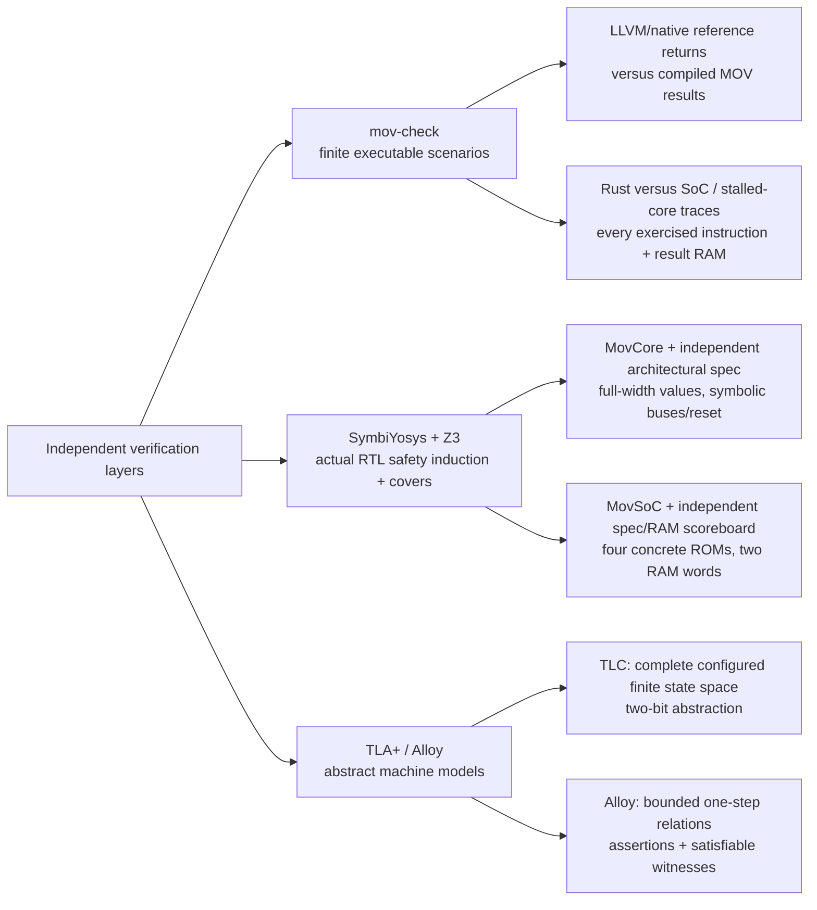

# Formal verification

## Verification map



Arrows group checks by evidence type; they are not a chain in which a small model proves RTL or a machine proof proves the compiler. Induction gives unbounded-time safety under each RTL harness's scope. Executable scenarios, finite abstract models and physical hardware measurements are different claims; no physical-board execution or whole-compiler correctness theorem is established here.


## Run

Inside `nix develop --impure`:

```sh
mov-formal
# Individual layers:
mov-formal --target core
mov-formal --target soc
mov-formal --target tla
mov-formal --target alloy
# Generate RTL/SBY inputs without executing solvers:
mov-formal --generate-only
```

Outputs default to `build/formal/`; `--build-dir PATH` overrides this. The runner resolves source paths relative to itself. Solver/tool failures, missing executables, failed assertions, unreachable cover goals and Alloy counterexamples produce a nonzero exit status. It does not manufacture proof statuses.

Alternative standalone tool installations can use `--sby`, `--tlc`, `--alloy`; TLA+ and Alloy jars can be supplied with `--tlc-jar`/`TLA2TOOLS_JAR` and `--alloy-jar`/`ALLOY_JAR`, plus `--java`. Nix's Alloy 6 wrapper is named `alloy6`.

## Full-width core: safety induction

`formal/harness.py:CoreFormal` instantiates the **actual `MovCore`**, not a replacement CPU. `ArchitecturalSpec` separately tracks PC, all four registers, halt/fault/code, phase and captured instruction. Its next-state equations decode the instruction independently; they do not import the core's decode/control outputs.

Assertions compare architecture, request-valid signals, instruction address, memory request address/value/direction while valid, and retirement every cycle. This covers:

* All four MOV forms and untouched-register preservation, including register aliases.
* Canonical encoding checks and precise decode/alignment/bus faults.
* Address and PC wrapping; PC read/write MMIO; successful HALT and invalid HALT reads.
* Fetch and memory stalls, error sampling only at completion, stopped-state preservation.
* Reset priority, cancellation and recovery.

Input instructions remain 64 bits; register/data/address/PC values remain 32 bits. Bus readiness, response data/errors and explicit reset are arbitrary symbolic inputs. No fairness/eventual-ready assumption is imposed. The normal synchronous-domain reset is also modeled. Initial values are the Amaranth-defined initialized/reset values.

Generated SBY tasks use Yosys RTLIL lowering, process lowering and memory mapping, then `smtbmc z3`. `mode prove`, depth 6 runs both base cases and temporal induction. **A successful induction proves safety for arbitrarily many cycles**, not merely six-cycle execution. `mode cover`, depth 64 demonstrates reachability of all MOV forms, MMIO/wrap/halt, illegal encodings, stalls/errors and reset transitions; covers are non-vacuity witnesses, not liveness proofs.

The core proof's memory interface contract is explicit: external data-bus memory mapping/data are responses from the environment. It cannot prove the contents of an arbitrary external memory, nor forbid a malicious target from committing a faulting store. No termination guarantee is made for a program or a permanently stalled bus.

## Concrete SoC integration: safety induction

`SoCFormal` instantiates actual `MovSoC` instances with two full-width RAM words and four immutable programs:

1. Store/read roundtrip, PC read, jump over an illegal instruction, HALT with `0x89abcdef`.
2. Out-of-RAM store.
3. Out-of-RAM load.
4. Out-of-image fetch.

It compares architectural transitions with the independent specification, verifies synchronous ROM/RAM response/handshake mapping, and compares **every RAM word** against a reset-persistent store scoreboard. CPU reset timing is arbitrary; reset must not erase RAM or commit cancelled stores. Successful halt and each fault are covered.

This is an unbounded-in-time proof **for these concrete ROMs and two-word RAM configurations**. It is not a proof for every program, every RAM capacity, FPGA vendor primitive mapping, place/route, physical hardware, metastability or board wiring. Differential simulation separately exercises the default 256-word SoC with many images.

## TLA+ template tool: finite state exploration

`formal/MovMachine.tla`/`.cfg` describe fetch/execute, copies, memory, PC/HALT, faults, stalls and reset. TLC explores the configured finite abstract machine:

* Two registers and two RAM words.
* Four values/PCs (two-bit abstraction).
* Five abstract addresses and 33 abstract instruction records.
* Nondeterministic instruction choice, readiness, errors and reset.

Invariants include type correctness, fault-implies-stop, precise faults, sticky stop, stall stability, reset priority, register/memory frame conditions, PC transitions and MOV semantics. Effective-address arithmetic/alignment is abstracted into address selection; this model does not prove the full-width decoder. Deadlock checking is disabled because stop/stall are allowed, not because safety errors are ignored.

## Alloy template tool: bounded relational checks

`formal/mov_machine.als` independently describes one abstract transition. Scope: exactly two State atoms, two registers, four Word/PC atoms, five addresses, two Booleans, eleven action types and one Step. This is **one-step finite relational checking**, not a temporal or full-width RTL proof.

Eight checks: `FaultImpliesStop`, `PreciseFault`, `StopSticky`, `RegisterFrame`, `MemoryFrame`, `PCTransition`, `ResetPreservesRAM`, `MoveSemantics`. Thirteen run commands require satisfiable witnesses for reset, stop/stall, fetch/fetch-fault, each MOV form, jump/halt and bad-instruction/memory faults.

The runner validates Alloy's solver receipt: every safety check must have no counterexample and every witness must have a solution. A process exit code alone is insufficient because Alloy can exit successfully after finding a counterexample.

## What no layer proves

No proof here establishes correctness of the Rust compiler's LLVM lowering, encoded return ABI, arbitrary-program termination, Rust/RTL equivalence for all possible inputs, or successful physical FPGA operation. The Rust tests, LLVM/native reference executions and instruction-by-instruction differential smoke cover exercised compiler programs, not a compiler-correctness or formal-equivalence theorem. Existing machine proofs apply to MOV execution, including generated MOV code under their stated interface/configuration scopes. See [verification results](verification.md) for observed outcomes and [compiler](compiler.md) for its supported source contract.
