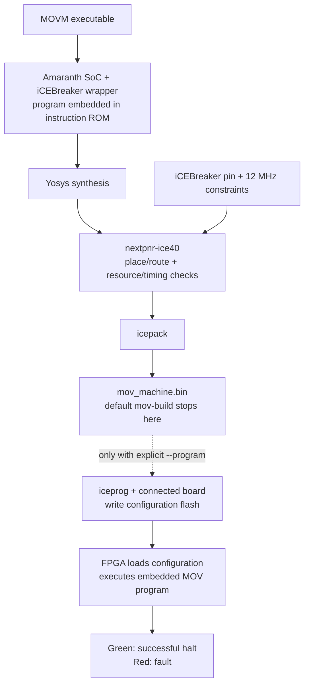

# Build and run

## Development shell

```sh
nix develop --impure
# Or use nix-direnv:
direnv allow
```

The shell uses `flake.lock` and installs Python dependencies from `uv.lock`. First entry downloads the Rust/Python/FPGA/formal toolchains. `devenv` may warn that the optional Cachix cache is not trusted; standard Nix cache downloads still work. No machine-wide settings need changing.

## Compile LLVM IR or C

```sh
mkdir -p build
mov-compile examples/llvm/sum.ll build/sum.mov
mov-run build/sum.mov --max-steps 500000
cargo run --locked -- exec-ir examples/llvm/loop.ll --max-steps 500000

# Generate 32-bit-pointer LLVM IR from C, then choose a function and arguments:
clang --target=i386-none-elf -S -emit-llvm -O1 -fwrapv \
  examples/llvm/sum.c -o build/sum.ll
mov-compile build/sum.ll build/c-sum.mov --entry sum --arg 17 --arg 25
mov-run build/c-sum.mov --max-steps 500000
```

The sum programs return decoded `result: 42`; the loop returns 55. LLVM/native reference executions are included in `mov-check`. Clang's Nix wrapper may warn about cross-target flags; this command emits textual IR, not a cross-linked executable. Do not use host-default 64-bit-pointer IR.

Compiler defaults: entry `main`, no arguments, 1024 physical RAM words, 32 logical source-memory bytes. Repeat `--arg` for scalar parameters; values accept decimal, signed decimal or hexadecimal and are truncated to the parameter width. `--entry`, `--arg`, `--memory-bytes` and `--ram-words` also work with `exec-ir`. `--memory-bytes` must be a power of two in 2–128. An explicit compiler RAM capacity is a limit, not preallocated output padding.

Compilation reports generated MOV count, exact required RAM and source-memory capacity on stderr. Unsupported IR and insufficient capacities fail before output is written. The versioned executable records runtime RAM/result requirements; default `mov-run`/`mov-build` capacities honor them.

Compiled-image final JSON adds unsigned `result` (or `null` on fault/budget exhaustion). `halt_code` is the physical address of the encoded return bits, not the source integer. Void entries return decoded zero. The FPGA computes those bits, but its status-only board interface does not transmit them to a host. See [compiler](compiler.md) for lowering, source restrictions and the return ABI.

## Native assembly


```sh
mkdir -p build
mov-assemble examples/copy.s build/copy.mov
mov-run build/copy.mov --max-steps 1000
```

Expected state:

```json
{"pc":11,"registers":[42,9,42,4294967288],"halted":true,"fault":false,"halt_code":42,"steps":10}
```

Direct Cargo equivalents:

```sh
cargo run --locked -- assemble examples/copy.s build/copy.mov
cargo run --locked -- run build/copy.mov --max-steps 1000
cargo run --locked -- exec examples/table-branch.s --max-steps 1000 --trace
```

`--max-steps` is required; infinite MOV-to-PC loops cannot hang the CLI. `--ram-words N` changes emulator RAM capacity (default max of 256 and the executable's requirement). Successful explicit halt exits 0, independent of `halt_code`/decoded result; a machine fault or exhausted budget exits 1; compiler/assembly/option/image/I/O errors exit 2. Errors are reported on stderr.

`--trace` writes a JSON object after each attempted instruction, followed by final state JSON. Trace rows add `memory_write: null` or `{ "address": ..., "value": ... }`, including successful PC/HALT MMIO stores. A faulting instruction has no memory-write event. The final row omits `memory_write`. Numeric fields are unsigned decimal.

The library exposes `compiler::{compile_ir, CompileOptions, CompiledProgram}`, `llvm::parse_module`, `assemble`, `Image`, `Instruction`, `Machine`, `State`, `StepOutcome` and `RunOutcome`. `Machine::step()` is architectural, not cycle-accurate; `Machine::run(max_steps)` returns a stop/budget outcome. `Machine::result()` validates/decodes the declared return ABI after successful halt. `ram_mut()` permits host initialization. `reset()` clears CPU state/step count but preserves RAM; compiler startup restores its private state. Image headers are validated on loading; instruction encodings are checked by execution, allowing precise machine faults.

## Reference FPGA: iCEBreaker

```sh
mov-build build/copy.mov
# Produces build/icebreaker/mov_machine.bin, plus RTL, constraints and tool logs.
# Only with a connected board, explicitly program its flash:
mov-build build/copy.mov --program
```

Board: iCEBreaker, Lattice iCE40UP5K-SG48, 12 MHz board clock. The `amaranth-boards` platform supplies verified resource definitions and tool commands. Yosys synthesizes; nextpnr-ice40 places/routes; icepack creates the bitstream; `--program` invokes iceprog. No board is programmed by the default build.

The program is embedded in ROM, so changing it requires rebuilding the bitstream. Default RAM is max of 256 and the image's requirement; `--ram-words 1..1024` selects capacity and must meet that requirement. The SoC accepts 1–16384 instructions, but actual FPGA ROM/RAM fit and timing must be checked for each image rather than inferred from those validation limits. Compiled images use the same build command: `mov-build build/sum.mov`.

* Green LED: successful explicit halt.
* Red LED: fault.
* Main user button: synchronized CPU reset; RAM persists until reconfiguration/power loss.

The board exposes status, not a UART console or runtime program loader. Inspect architectural registers/halt code and decode compiled result RAM with the emulator or RTL simulation. No custom PCB is needed for this reference build. Electrical constraints are the board's 3.3 V resources; do not attach 5 V signals to FPGA pins.

### Build is not programming



The `.bin` build and timing report have been exercised; flashing and physical execution have not. Changing the program requires rebuilding and explicitly flashing a new bitstream. LEDs indicate stop status, not the decoded source return value; simulation, formal results and place/route estimates do not substitute for a hardware run.


Board-neutral exports:

```sh
mov-build build/copy.mov --emit-rtl build/mov_soc.il
mov-build build/copy.mov --emit-rtl build/mov_soc.v
```

Exports contain the core, synchronous ROM/RAM and architectural outputs; their clock/reset ports are generated by Amaranth. Use `MovCore` directly for a different memory system or `MovSoC` for a different board wrapper.

## Verification

```sh
mov-check
mov-formal
```

`mov-check` runs Rust behavioral tests, builds the CLI, assembles example/boundary/generated programs, and compares every architectural transition against both the real synchronous-memory SoC and a core with randomized bus stalls. It additionally compiles LLVM loops, calls/arithmetic, source-memory operations and actual Clang output; checks LLVM/native reference results; and decodes the actual RTL RAM result. It checks stopped-state stability and reset cancellation/RAM persistence. Generated native cases have a fixed seed; `--random-cases N` changes their number. It does not run formal proofs or place/route; those commands are separate.

For the precise formal claims and model bounds, see [formal verification](formal.md). The [compiler contract](compiler.md) states the executable LLVM subset and resource limits.

## Without the Nix shell

Install Rust 1.88 or newer and a native linker, Python 3.12 and uv; run `uv sync --frozen`, set `PYTHONPATH="$PWD/hw"`, and use `uv run python` for Python commands. Clang/LLVM are needed for the C/reference verification path, not for compiling existing supported `.ll` files. RTL proofs additionally require compatible Yosys, sby and Z3; FPGA builds require nextpnr-ice40 and icestorm; abstract models require TLA+ and Alloy 6. The locked Nix shell is the exercised, reproducible path.
